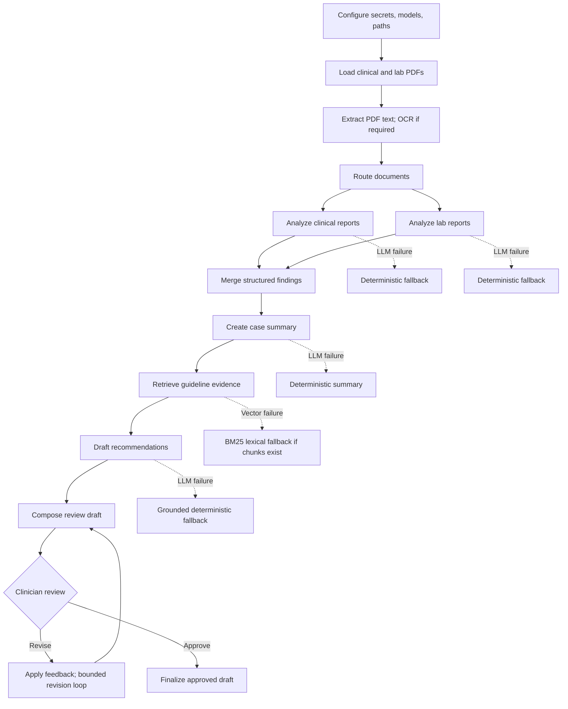

# Clinical Report Assistant: End-to-End Workflow and Architecture

This guide describes how to configure, run, and analyze the clinical report assistant notebook as one workflow. It reflects the notebook structure and the errors shared in this conversation. The notebook currently has deterministic fallbacks and a human review pause; it is not an autonomous clinical decision system.

## 1. Workflow at a glance



The notebook stores workflow state in SQLite so a paused clinician review can be resumed with the same thread ID. The guideline index uses persistent Chroma for dense retrieval and BM25 for lexical retrieval. `EnsembleRetriever` combines them when both are ready.

## 2. Configure the environment before running

### API key and models

Use an API key belonging to the Google AI project whose quota and billing you have checked. Store the key in the notebook environment or a local `.env` file that is excluded from version control; never paste a real key into a shared notebook or logs.

The notebook supports these configuration variables:

```text
GOOGLE_API_KEY=your_key
LLM_MODEL_FAST=gemini-3.8-flash
LLM_MODEL_SMART=gemini-3.8-flash
EMBEDDING_MODEL=gemini-embedding-2
```

These are example settings for the current setup, not a promise that a model has quota in your project. The notebook's code defaults are not all aligned with this example: in the reviewed notebook, the smart tier defaults to `gemini-1.5-pro`. Environment variables can override code defaults. Set both LLM variables explicitly to models currently available to your project, then restart the kernel and rerun from the first code cell. Restarting clears cached settings, model clients, and index objects.

Check the official [Gemini model catalog](https://ai.google.dev/gemini-api/docs/models) and [rate limits](https://ai.google.dev/gemini-api/docs/rate-limits) before choosing models. Gemini 3.8 Flash is listed as a stable model in the current catalog. Gemini model availability, quota, pricing, and preview status can change.

A valid model ID and API key do not guarantee quota. The API key's project must have access to the selected model and a nonzero request/token limit. Billing may be required to move beyond free-tier quota.

### Paths and packages

1. Confirm `data_root` points to the expected data folder.
2. Confirm the patient input directory contains the PDFs referenced by `SELECTED_FILES`.
3. Confirm `guideline_dir` contains readable guideline PDFs. Without guideline chunks, neither dense retrieval nor BM25 can return evidence.
4. Install the notebook's declared Python dependencies into the same environment as the Jupyter kernel.
5. Keep a consistent set of LangChain packages. The notebook imports `EnsembleRetriever` from `langchain_classic.retrievers`; confirm that import works in the environment before starting a full run.
6. Choose persistent, writable locations for Chroma, embedding data if used, and the SQLite checkpoint database.

## 3. Run and analyze in this order

### Step 1: Validate configuration

Before processing reports, inspect the loaded settings without printing secrets:

```python
s = get_settings()
print("Fast model:", s.llm_model_fast)
print("Smart model:", s.llm_model_smart)
print("Embedding model:", s.embedding_model)
print("Input directory:", s.patient_input_dir)
print("Guideline directory:", s.guideline_dir)
print("Chroma directory:", s.chroma_persist_dir)
```

If values do not match the environment, restart the kernel, set the variables before constructing cached clients, and rerun the settings/model cells. Do not print `GOOGLE_API_KEY`.

### Step 2: Validate source files and parsing

Check that every selected PDF exists and is readable. The parser extracts native PDF text first and may use OCR for scanned pages. Review parse status and extracted text length; poor OCR or empty text can cause later routing and extraction to fail even when the model is available.

### Step 3: Route documents

The workflow classifies inputs as clinical reports, lab reports, mixed documents, or unsupported. Review `route_results` for the route, confidence, and matched signals. Routing determines which analysis branches run.

### Step 4: Analyze clinical and laboratory content

Report analysis and lab analysis run as separate branches and are merged afterward. Each branch records an error and uses a deterministic fallback if the LLM call fails. Inspect `errors`, `report_analysis`, and `lab_analysis`; verify all extracted values, units, ranges, and source files against the original PDFs.

### Step 5: Build the summary and guideline retrieval

The summary is generated from structured upstream findings. Guideline retrieval uses the case query and returns evidence with source filename and page number where available. Check `retrieved_evidence`, `rag_retrieval_mode`, and `guideline_context` before evaluating recommendations.

Expected retrieval modes include hybrid retrieval and lexical fallback. Lexical fallback is useful when the vector index is unavailable, but it requires successfully loaded guideline chunks and may have weaker semantic recall.

### Step 6: Generate recommendations and request clinician review

Recommendations should be grounded in retrieved guideline evidence. Review both the evidence and recommendation draft. The graph pauses for an explicit clinician decision. `approve` finalizes the reviewed draft; `revise` requires feedback and starts a bounded revision loop. Do not treat a generated or fallback draft as approved until a clinician has reviewed it.

### Step 7: Review observability and evaluation

Inspect workflow logs, errors, retrieval mode, evidence, and node metrics. The notebook's current evaluation cell uses toy examples and lightweight token-overlap proxies. Those metrics are not Ragas results, do not exercise production retrieval, and do not establish clinical accuracy. A meaningful evaluation requires a representative, clinician-reviewed dataset with expected answers and relevant source contexts.

## 4. Troubleshooting the reported errors

### A. `429 RESOURCE_EXHAUSTED` for `gemini-3.1-pro-preview`

The shared log reports that the free-tier request and input-token quotas for the project/model are `0`. This is an account/project quota condition, not a missing Python module. Short `retryDelay` messages are backoff advice; repeatedly retrying will not make a zero quota available.

1. Check the project associated with `GOOGLE_API_KEY` in Google AI Studio's rate-limit view.
2. Confirm billing/access and nonzero quota for the model you intend to call.
3. Set `LLM_MODEL_FAST` and `LLM_MODEL_SMART` to accessible model IDs. If using the example above, ensure the project actually has quota for `gemini-3.8-flash`.
4. Restart the notebook kernel and rerun from the first cell to clear cached settings and model clients.
5. Make a small standalone model call before rerunning the full clinical workflow.

If the workflow logs `Lab LLM failed`, `Report LLM failed`, `Summary LLM failed`, or `Reco LLM failed`, it indicates that stage used a fallback. The graph may continue, but output quality and retrieval grounding can be reduced. Read the complete error rather than assuming all fallbacks have the same cause.

### B. `name 'EnsembleRetriever' is not defined`

This is a Python import/name error. Ensure the import is present and supported by the installed packages:

```python
from langchain_classic.retrievers import EnsembleRetriever
```

Restart the kernel and run the imports cell before the index-building cell. If this import path is unavailable in the environment, inspect the installed LangChain package versions and use the documented path for that exact version; avoid mixing incompatible LangChain package versions.

### C. `vector_index_unavailable`

This status means the dense/hybrid index was not ready. Inspect the earlier `vector_index_build_failed` log, then check the index status:

```python
idx = get_guideline_index()
print(idx.stats)
```

Check `vector_index_error`, `guideline_pdf_count`, and `chunk_count`.

- If the guideline directory is missing or has no PDFs, correct `guideline_dir` and add the intended guideline files.
- If PDF loading or splitting failed, fix that source-file error first.
- If the embedding call failed, confirm the embedding model ID, API project, and embedding quota.
- If Chroma cannot write or load, confirm the persistence directory is writable and not corrupted.
- If `chunk_count` is zero, lexical fallback has nothing to search.
- If the embedding model changed, rebuild the vector index; never combine vectors produced by different embedding models in one collection.

After fixing the cause, clear or rebuild only the affected Chroma collection using the project's deliberate maintenance procedure, then rerun the index cell and test a known query. Preserve any index data you need before deleting or rebuilding it.

### D. LangGraph deprecation warning for `create_react_agent`

The reviewed notebook already imports `create_agent` from `langchain.agents`. If a warning still appears, it likely comes from a different or stale notebook cell or from another installed package. Search the executed code for `create_react_agent`, update the import and invocation to the API supported by the installed LangChain version, restart the kernel, and rerun all cells. A deprecation warning is distinct from a model quota or vector-index failure.

## 5. Architecture responsibilities

| Component | Responsibility | Main checks |
|---|---|---|
| Settings/model factory | Load API credentials, model IDs, timeouts, paths, and retrieval parameters | Correct project/key; model IDs available; quota nonzero |
| PDF parser | Extract native text and use OCR when required | File exists; text quality; OCR page/size caps |
| Router | Classify documents and select analysis branches | Route and confidence are reasonable |
| Report/lab agents | Extract structured clinical and lab information | Values, units, ranges, provenance checked against PDF |
| Merge and summary | Combine findings into a consistent case summary | No unsupported facts; missing data explicit |
| Guideline index | Load/split PDFs; create or load Chroma and BM25 corpus | Guideline count, chunk count, embedding and persistence health |
| Hybrid retriever | Combine dense MMR and BM25 using configured weights | Correct mode; relevant, cited evidence returned |
| Recommendation agent | Draft evidence-grounded next-step recommendations | Each recommendation traceable to retrieved evidence |
| Human review | Approve or request bounded revisions | Only an explicit clinician approval finalizes |
| Observability/evaluation | Record errors, fallback modes, evidence, and timings | No secrets/PHI in logs; evaluation data is representative |

## 6. Acceptance checklist

Before considering a run successful, confirm:

- [ ] The notebook uses the intended API key project, and selected model quotas are available.
- [ ] Model settings printed at runtime match the intended configuration.
- [ ] Selected clinical input PDFs and guideline PDFs exist and parse successfully.
- [ ] `EnsembleRetriever` imports successfully and the vector index reports ready.
- [ ] A known guideline query returns relevant evidence with source metadata.
- [ ] Every fallback/error is understood; no silent error is treated as a successful LLM result.
- [ ] Extracted clinical and lab content has been checked against the source documents.
- [ ] Recommendations and evidence are reviewed by a qualified clinician.
- [ ] A final report is marked approved only after the human review step.
- [ ] Evaluation claims are based on a reviewed dataset, not the notebook's toy proxy examples.

## References

- [Gemini API models](https://ai.google.dev/gemini-api/docs/models)
- [Gemini API rate limits](https://ai.google.dev/gemini-api/docs/rate-limits)
- [LangChain classic retrievers](https://python.langchain.com/docs/integrations/retrievers/)

